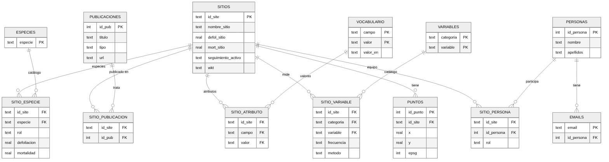

```{r}
#| include: false
source("R/create_site.R")
```

# Mapa

## {.sidebar width="260px"}

```{r}
htmltools::tagList(filtros, resumen)
```

## Row

### Column {width="60%"}

```{r}
#| title: "Sitios de estudio"
mapa
```

### Column {width="40%"}

```{r}
#| title: "Datos"
tabla
```

# Acerca de {scrolling="true"}

## Row

::: {.card .acerca title="La base de datos ReDeC"}

La **Red Española de Decaimiento Forestal (ReDeC)** recopila los sitios de estudio
del decaimiento forestal en la península ibérica y Baleares: dónde están, quién los estudia,
qué especies se ven afectadas, qué se mide y qué se ha publicado sobre ellos.

**Versión:** v1 · 13/11/2026

**Contenido de la versión v1**

| Contenido | N |
|---|---:|
| Sitios de estudio | 253 |
| Investigadores responsables | 43 |
| Investigadores participantes | 83 |
| Gestores | 16 |
| Publicaciones e informes | 97 |
| Especies leñosas registradas en los sitios | 26 |
| Variables medidas (registros sitio–variable) | 3.632 |

**Origen de los datos.** Los datos han sido aportados por diferentes investigadores y gestores. Una vez leídos los datos y se ha llevado a cabo un proceso de depuración de errores, normalización e integración. Se ha generado una base de datos en formato SQLite. Aunque también se pueden descargar en otros formatos (ver apartado de Descargas). 

**Organización.** El **sitio** es la unidad central: un registro por sitio en la
tabla `sitios`, con los datos que tienen un único valor. Todo lo que un sitio puede
tener varias veces (personas, publicaciones, especies, variables, tipos de masa,
puntos) va en tablas aparte enlazadas por `id_site`. Los valores de las listas
desplegables están en catálogos (`vocabulario`, `especies`, `variables`), de modo
que cada valor se escribe siempre igual.

**Identificador de sitio.** Cada sitio se identifica con las iniciales del responsable
(nombre, primer y último apellido) seguidas de un número, por ejemplo `GGI01`.

**Coordenadas.** 238 sitios tienen coordenadas puntuales y 21 un polígono (algunos tienen ambos).
En el mapa todos se representan con un punto en WGS84: el punto del sitio, el
centro de sus puntos o un punto dentro del polígono.

**Datos en esta web.** Solo se muestran los sitios cuyos responsables autorizaron su
publicación, y solo el contacto del responsable.

:::


## Row

::: {.card .acerca title="Esquema entidad–relación"}

{fig-alt="Esquema entidad-relación de la base de datos ReDeC"}

:::

## Row

::: {.card title="Descripción de las tablas"}

| Tabla | Una fila es… | Contenido |
|---|---|---|
| `sitios` | un sitio | Nombre, permisos, % de defoliación y mortalidad del sitio, gestión previa, objetivo, metodología, cobertura temporal y observaciones. |
| `puntos` | un punto de un sitio | Coordenadas x, y en su sistema original (código EPSG). Un sitio puede tener varios puntos (parcelas). |
| `personas` | una persona | Nombre y apellidos, sin duplicados. |
| `emails` | un email | Correos de cada persona (puede tener varios). |
| `sitio_persona` | una persona en un sitio | Papel en el sitio: `responsable` (uno por sitio), `investigador` o `gestor`. |
| `publicaciones` | una publicación | Título, tipo (científica, informe, sin publicar, otros) y enlace o DOI. |
| `sitio_publicacion` | una publicación en un sitio | Enlaza publicaciones y sitios. Una publicación puede tratar varios sitios. |
| `sitio_especie` | una especie en un sitio | Papel de la especie (dominante, principal, secundaria) y su % de defoliación y mortalidad. |
| `sitio_atributo` | un valor de un campo de opción múltiple | Tipo de masa, territorio, gestión posterior, factores principal y secundario, metodología, método de defoliación y escala. |
| `sitio_variable` | una variable medida en un sitio | Variable, frecuencia de medida y método. |
| `vocabulario` | un valor admitido | Valores de las listas desplegables, con su traducción al inglés. |
| `especies` | una especie | Catálogo de especies leñosas. |
| `variables` | una variable | Catálogo de variables por categoría. |

**Descarga.** Los datos que se muestran en esta web pueden descargarse desde la tabla
del mapa (botones CSV y Excel) o directamente aquí:
[sitios.csv](data/sitios.csv) · [publicaciones.csv](data/publicaciones.csv)

:::